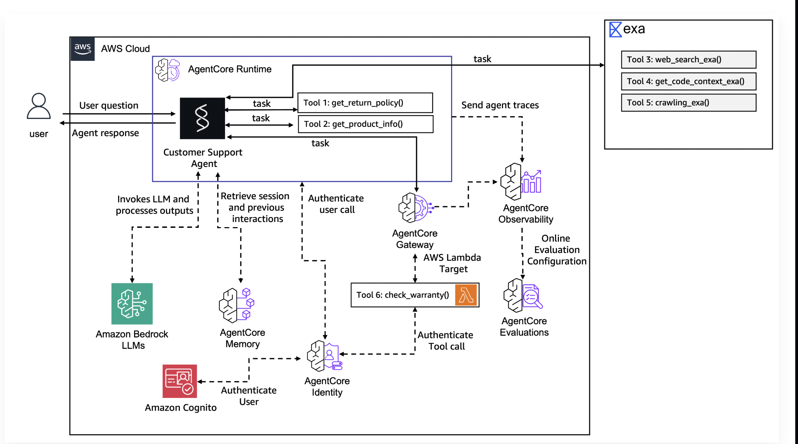
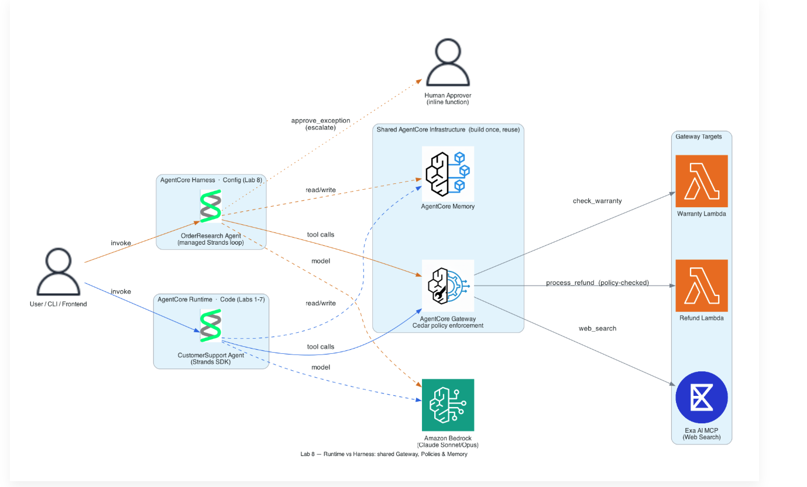

# Production-Grade Customer Support Agent on Amazon Bedrock AgentCore

A customer-support AI agent taken from a laptop prototype to a **secured, observable, governed, and continuously-evaluated** production deployment on **Amazon Bedrock AgentCore** — built with the **Strands Agents SDK** and deployed serverlessly via CDK/CloudFormation.

This repository is a hands-on implementation and architectural deep-dive: beyond standing the system up, it works through the production concerns that sit *between* a working agent and real users — **authentication, authorization, memory, tool routing, observability, evaluation, and governance** — and documents the real debugging and design decisions along the way.

> **Scope:** built on the AWS *"Getting Started with Amazon Bedrock AgentCore"* workshop, then extended, instrumented, debugged, and documented as a reference architecture. The deployed infrastructure has been torn down (see [Cost & Teardown](#cost--teardown)); the code and architecture remain as the artifact.

---

## Architecture

**Full system — code-first agent + AgentCore production services:**



**Runtime vs. Harness — one shared backend, two agent build styles:**



The second diagram captures the key architectural idea: AgentCore primitives (**Gateway, Memory, Policy, Identity**) are built **once as shared infrastructure**, then reused by multiple agents — whether written in code (Strands SDK) or assembled declaratively (AgentCore Harness).

---

## What it does

A conversational support agent that:

- Answers **product** and **return-policy** questions and checks **warranty** status.
- Processes **refunds** — but only within **policy-enforced** limits and reasons.
- **Remembers** a returning customer across sessions (name, preferences) via managed long-term memory.
- Runs each user in an **isolated session**, behind **authenticated** endpoints, with **every request traced and quality-scored**.

---

## AgentCore services used

| Service | Role in this system |
|---|---|
| **AgentCore Runtime** | Serverless, session-isolated microVM hosting for the agent (8-hour sessions, scale-to-zero). |
| **AgentCore Memory** | Managed short-term (per-session) + long-term **semantic/summarization** memory, scoped per user (actor). |
| **AgentCore Gateway** | Turns Lambda functions into **MCP tools** behind one secured endpoint, with semantic tool discovery. |
| **AgentCore Identity** | OAuth/JWT authentication for both machine-to-machine and human-login flows (Amazon Cognito). |
| **AgentCore Policy** | **Cedar-based** deterministic authorization — governs *what* an authenticated caller may do (e.g. refund limits), independent of the model's reasoning. |
| **AgentCore Observability** | Automatic **OpenTelemetry** tracing of every invocation → CloudWatch (Transaction Search). |
| **AgentCore Evaluations** | **Online evaluation** (goal-success, correctness, tool-use/trajectory) + **A/B testing** of prompt variants with statistical significance. |
| **AgentCore Harness** | **Zero-code** declarative agent (`OrderResearchAgent`) reusing the same Gateway/Memory/Policy backend. |

**Foundation model:** Anthropic Claude (Sonnet) via Amazon Bedrock. **Agent framework:** Strands Agents SDK. **IaC:** AWS CDK → CloudFormation.

---

## Production capabilities demonstrated

- **Serverless deployment** — code-first Strands agent packaged to an ARM64 container (cloud-built via CodeBuild) and deployed to AgentCore Runtime; endpoint/version indirection for zero-downtime updates and rollback.
- **Identity & access** — the full **AuthN → AuthZ** split: OAuth (Cognito) proves *who* the caller is (M2M client-credentials for service-to-service, authorization-code for human login); Cedar policies govern *what* they can do. Policy enforcement is **independent of the agent's prompt** — verified by (failed) jailbreak attempts.
- **Memory** — managed cross-session semantic memory keyed to the authenticated user identity, so a returning customer is recognised across fresh sessions.
- **Tools at scale** — Lambda-backed tools exposed as MCP through Gateway, authenticated per-call, with managed and third-party (Exa MCP / web search) targets.
- **Observability** — OpenTelemetry spans for every agent/model/tool call, surfaced in CloudWatch — the basis for diagnosing real issues (e.g. a model `ServiceUnavailable` blip, or an agent that *claimed* a side-effect it never performed).
- **Evaluation & optimization** — online quality scoring on live traffic, plus a prompt **A/B test** (control vs. treatment) read for **statistical significance** before any promotion decision — i.e. *measure, don't guess*.
- **Governance** — Cedar policies in **log-only (shadow) → enforce** rollout, the safe way to ship an authorization change against real traffic.

---

## Repository structure

```
.
├── app/
│   ├── CustomerSupport/        # code-first Strands agent (Runtime) + frontend + tool schemas
│   ├── CustomerSupportAB/      # A/B test config-bundle agent
│   └── OrderResearchAgent/     # zero-code Harness agent
├── agentcore/                  # AgentCore project config + CDK app (IaC)
├── docs/                       # architecture diagrams
├── AGENTS.md                   # agent instructions / configuration
├── requirements-snapshot.txt   # pinned dependencies
└── README.md
```

---

## Deploy (high level)

> Requires AWS credentials, Bedrock model access (Claude) in `us-east-1`, the AgentCore starter toolkit, and the prerequisite stack (Cognito + tool Lambdas).

```bash
# run locally
agentcore dev

# deploy to AWS (CDK → CloudFormation: Runtime, Gateway, Memory, Policy, etc.)
agentcore deploy

# invoke the deployed agent
agentcore invoke "What is the return policy for audio products?"
```

---

## Cost & Teardown

Designed to be **torn down cleanly** — the infrastructure for this project has been deleted and nothing bills at idle. Key cost notes learned building it:

- **Runtime** bills only on active compute; an idle, deployed runtime is ~\$0. The gotcha is **session memory**, billed for the session lifetime (default 15-min idle tail).
- **Memory** long-term records bill hourly (7-day minimum retention) — remember to delete.
- **Observability** (CloudWatch) and **Evaluations** (judge-model tokens) are standing meters — pause/stop when not actively measuring.
- Full teardown = delete the AgentCore CloudFormation stack, then sweep ECR images, CloudWatch log groups, and CLI-created IAM roles.

Teardown order: **stop the meters** (A/B test, online evals) → **delete the stack** → **sweep stragglers** → **verify empty** (`agentcore status` + CloudFormation + a budget-alarm check).

---

## Key lessons (the honest ones)

- An agent reporting **"✅ done" is not evidence it's done** — verify side-effects independently. (This is exactly why observability + trajectory evaluation exist.)
- **OAuth errors are diagnostic:** `invalid_token` = AuthN broke; `insufficient_scope` = valid token, missing permission (AuthZ). Reading *which* tells you where to look.
- **Guardrails/policies must sit outside the model's reasoning** — a prompt injection can corrupt the agent's judgment and still fail to bypass a deterministic policy check.
- **Never commit trace/log artifacts or credentials** — AWS SDK traces capture auth context; `.gitignore` them and keep secret scanning on.

---

## Acknowledgments

Built on AWS's *"Getting Started with Amazon Bedrock AgentCore"* workshop (AWS Workshop Studio), using the open-source **Strands Agents SDK**. Architecture diagrams and documentation are my own.